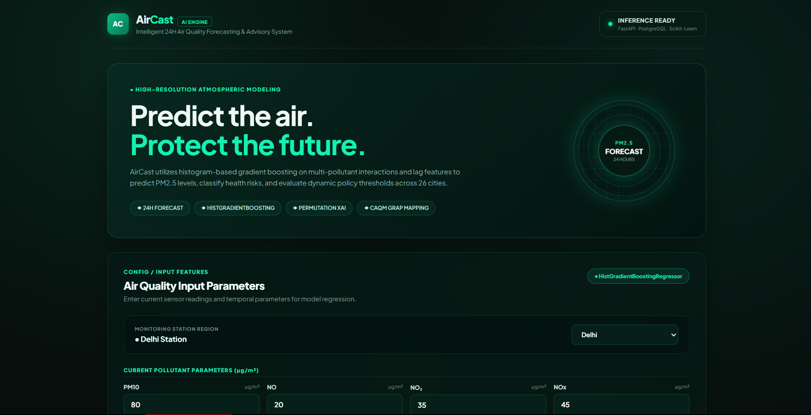
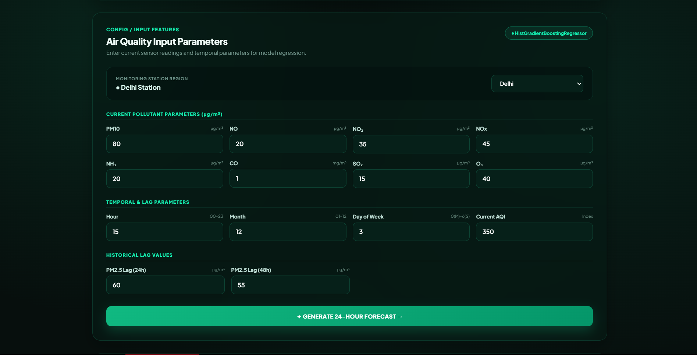
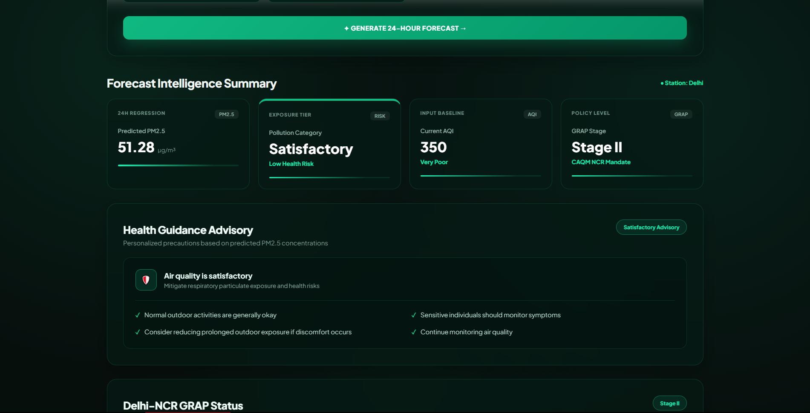
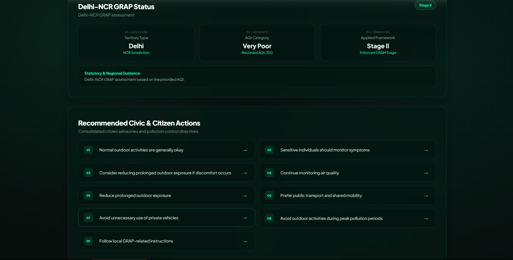
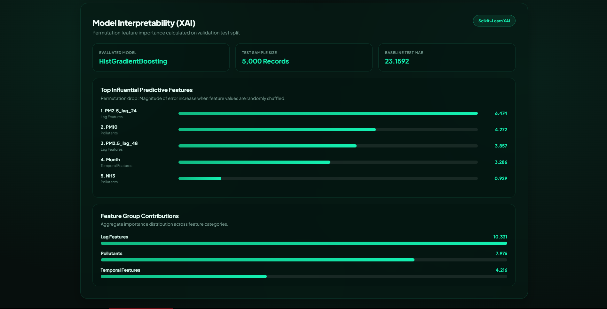
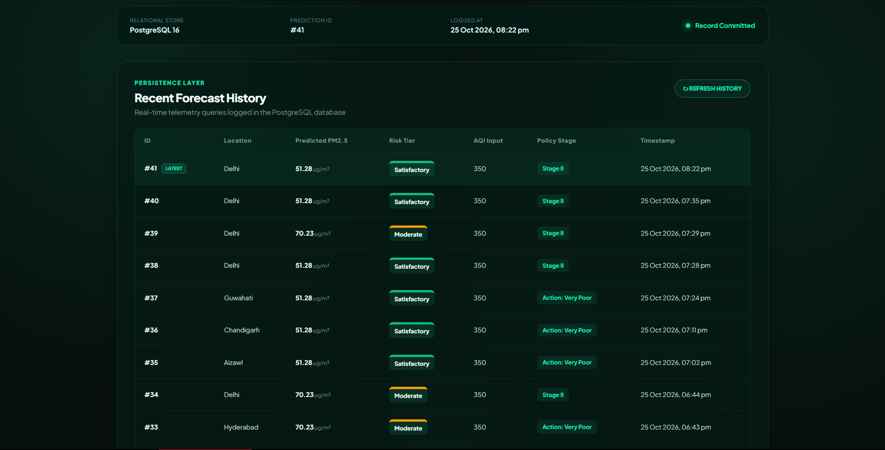
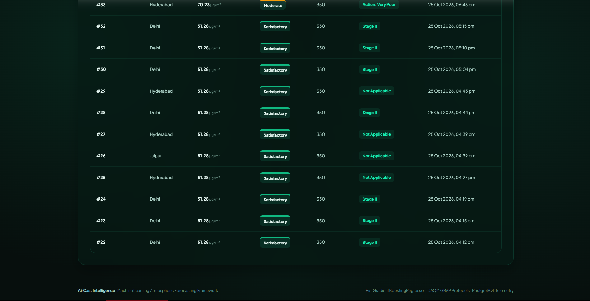

# 🌍 AirCast — AI-Based Air Quality Forecasting & Advisory System

AirCast is an AI-powered air quality forecasting and advisory system designed to predict **PM2.5 levels 24 hours ahead** and convert the prediction into understandable risk information, health guidance, and air-quality action recommendations.

The system combines **Machine Learning, Explainable AI, FastAPI, React, and PostgreSQL** into an integrated dashboard for air-quality analysis.

---

## ✨ Key Features

- 🔮 **24-hour PM2.5 Forecasting**
- 🤖 Machine Learning based prediction using `HistGradientBoostingRegressor`
- 📊 Air-quality risk classification
- 🩺 Health advisory based on predicted PM2.5 risk
- 🚦 Delhi-NCR GRAP assessment based on provided AQI
- 🏙️ AirCast Air Quality Action Plan for non-NCR locations
- 🧠 Explainable AI using permutation feature importance
- 📈 Feature-group contribution analysis
- 🗄️ PostgreSQL prediction history
- ⚡ FastAPI backend
- 🎨 Interactive React dashboard
- 🛡️ Input validation using Pydantic
- 📱 Responsive dashboard interface
- 🌐 Support for 26 cities
- 💾 Persistent prediction records

---

## 🎯 Project Objective

The main objective of AirCast is to provide a practical system that can:

1. Forecast the PM2.5 concentration for the next 24 hours.
2. Classify the predicted air-quality risk.
3. Provide health-related guidance.
4. Assess Delhi-NCR GRAP status when AQI is provided.
5. Provide an AirCast action level for non-NCR locations.
6. Explain which input features contribute most to the forecasting model.
7. Store prediction results for historical analysis.

---

## 🔄 System Workflow

```text
CPCB Air Quality Dataset
          ↓
Data Validation
          ↓
Preprocessing
          ↓
Feature Engineering
          ↓
24-Hour PM2.5 Forecast
          ↓
Risk Classification
          ↓
Health Advisory
          ↓
GRAP / AirCast Action Assessment
          ↓
Explainable AI
          ↓
FastAPI Backend
          ↓
React Dashboard
          ↓
PostgreSQL Prediction History
```

---

## 🤖 Machine Learning

### Target

The model predicts:

```text
PM2.5 concentration 24 hours ahead
```

Target variable:

```text
PM2.5_target_24h
```

### Input Features

#### Pollutant Features

- PM10
- NO
- NO2
- NOx
- NH3
- CO
- SO2
- O3

#### Temporal Features

- Hour
- Month
- DayOfWeek

#### Lag Features

- PM2.5_lag_24
- PM2.5_lag_48

The model uses the previous 24-hour and 48-hour PM2.5 values as lag features for forecasting.

---

## 📊 Dataset

The project uses the **CPCB India Air Quality Dataset (`city_hour.csv`)**.

Dataset characteristics used in the project:

- **707,875 rows**
- **26 cities**
- **Hourly observations**
- **2015–2020**
- **16 raw columns**

AQI and `AQI_Bucket` are excluded from the forecasting features to avoid target leakage.

`Year` is also excluded from the final model features.

---

## 🏆 Model Performance

Two regression models were evaluated:

| Model | MAE | RMSE | R² |
|---|---:|---:|---:|
| Random Forest | 19.2630 | 31.8347 | 0.5165 |
| HistGradientBoostingRegressor | **18.3886** | **30.3002** | **0.5620** |

### Final Model

```text
HistGradientBoostingRegressor
```

The final trained model is stored in:

```text
models/trained_model.pkl
```

The saved model package also contains the model name, feature list, target information, and split date.

---

## ⚠️ Risk Classification

AirCast converts predicted PM2.5 into project-level risk categories:

| Predicted PM2.5 | Category | Risk Level |
|---:|---|---|
| ≤ 30 | Good | Low |
| ≤ 60 | Satisfactory | Low |
| ≤ 90 | Moderate | Medium |
| ≤ 120 | Poor | High |
| ≤ 250 | Very Poor | Very High |
| > 250 | Severe | Severe |

> These are AirCast project-level PM2.5 risk thresholds and should not be interpreted as official GRAP thresholds.

---

## 🚦 GRAP & Air Quality Action Assessment

AirCast separates **Delhi-NCR GRAP assessment** from its **non-NCR Air Quality Action Plan**.

### Delhi-NCR

When the selected city belongs to Delhi-NCR and an AQI value is provided, AirCast evaluates the corresponding GRAP stage:

| AQI | AirCast GRAP Assessment |
|---:|---|
| ≤ 200 | No GRAP Stage |
| 201–300 | Stage I |
| 301–400 | Stage II |
| 401–450 | Stage III |
| > 450 | Stage IV |

The GRAP assessment is based on the **provided AQI**, not directly on the predicted PM2.5 value.

### Non-NCR

For cities outside Delhi-NCR, AirCast uses its own project-level air-quality action framework:

| AQI | AirCast Action Level |
|---:|---|
| ≤ 50 | Good |
| ≤ 100 | Satisfactory |
| ≤ 200 | Moderate |
| ≤ 300 | Poor |
| ≤ 400 | Very Poor |
| > 400 | Severe |

This framework is presented as an **AirCast project action plan**, not as an official CPCB/GRAP classification.

---

## 🧠 Explainable AI

AirCast includes an Explainable AI module based on **permutation feature importance**.

The implementation uses:

- Up to 5,000 samples
- 5 permutation repeats
- MAE-based importance evaluation

The major feature groups are:

```text
Lag Features
Pollutants
Temporal Features
```

Example of the strongest features identified during model analysis:

1. PM2.5_lag_24
2. PM10
3. PM2.5_lag_48
4. Month
5. NH3

This helps users understand which environmental and temporal variables contribute most to the forecasting model.

---

## 🛠️ Technology Stack

### Machine Learning

- Python
- Pandas
- NumPy
- Scikit-learn
- Joblib

### Backend

- FastAPI
- Uvicorn
- Pydantic
- PostgreSQL
- Psycopg2
- Python-dotenv

### Frontend

- React
- Vite
- JavaScript
- CSS

### Database

- PostgreSQL

### Development Tools

- VS Code
- Git
- GitHub

---

## 📁 Project Structure

```text
AirCast/
│
├── backend/
│   ├── main.py
│   ├── database.py
│   ├── test_database.py
│   │
│   ├── ml/
│   │   ├── compare_models.py
│   │   ├── explain.py
│   │   ├── predict.py
│   │   └── train_model.py
│   │
│   ├── preprocessing/
│   │   └── preprocess.py
│   │
│   └── services/
│       ├── advisory.py
│       ├── grap.py
│       └── risk.py
│
├── data/
│   └── city_hour.csv
│
├── models/
│   └── trained_model.pkl
│
├── frontend/
│   ├── public/
│   ├── src/
│   ├── package.json
│   ├── package-lock.json
│   └── vite.config.js
│
├── screenshots/
│   ├── dashboard.png
│   ├── prediction.png
│   ├── forecast-summary.png
│   ├── action-plan.png
│   ├── xai.png
│   ├── history.png
│   └── history-details.png
│
├── README.md
├── requirements.txt
├── test_data.py
└── .gitignore
```

---

## ⚙️ Installation

### 1. Clone the repository

```bash
git clone https://github.com/Mayankvarshney051/AirCast.git
cd AirCast
```

### 2. Create a Python virtual environment

```powershell
python -m venv venv
```

Activate it:

```powershell
venv\Scripts\activate
```

### 3. Install Python dependencies

```powershell
pip install -r requirements.txt
```

---

## 🔐 Environment Configuration

Database credentials are stored using environment variables instead of being hardcoded in the source code.

Create a `.env` file in the project root:

```env
DB_HOST=localhost
DB_PORT=5432
DB_NAME=aircast_db
DB_USER=postgres
DB_PASSWORD=YOUR_POSTGRES_PASSWORD
```

Do **not** commit `.env` to GitHub.

The project `.gitignore` excludes:

```text
.env
venv/
__pycache__/
*.pyc
node_modules/
dist/
```

---

## 🗄️ PostgreSQL Setup

Create a PostgreSQL database named:

```text
aircast_db
```

The backend uses PostgreSQL to store prediction history.

Each saved prediction can contain:

- Prediction ID
- Prediction time
- City
- Predicted PM2.5
- Risk category
- Risk level
- AQI
- GRAP / AirCast action assessment

---

## ▶️ Running the Backend

From the project root:

```powershell
uvicorn backend.main:app --reload
```

The API will be available at:

```text
http://127.0.0.1:8000
```

FastAPI interactive documentation:

```text
http://127.0.0.1:8000/docs
```

---

## ▶️ Running the Frontend

Open another terminal:

```powershell
cd frontend
npm install
npm run dev
```

Vite will provide the local frontend URL.

Open the displayed `localhost` URL in your browser.

---

## 🔌 API Endpoints

### Health Check

```http
GET /
```

Checks backend availability and basic system status.

### PM2.5 Prediction

```http
POST /predict
```

Accepts pollutant, temporal, lag, city, and optional AQI information and returns the complete AirCast prediction and advisory response.

### Explainability

```http
GET /explain
```

Returns feature importance and feature-group contribution information.

### Prediction History

```http
GET /history
```

Returns stored prediction records from PostgreSQL.

---

## 🛡️ Input Validation

The FastAPI backend validates incoming prediction parameters using Pydantic.

Examples of validation rules:

```text
PM pollutant values ≥ 0
Hour: 0–23
Month: 1–12
DayOfWeek: 0–6
AQI ≥ 0
```

Invalid input requests return a proper HTTP `422` validation response.

---

## 📸 Dashboard Screenshots

### 🏠 AirCast Dashboard



### 🔮 PM2.5 Forecast & Risk Assessment



### 📊 Forecast Summary



### 🚦 Air Quality Action Plan



### 🧠 Explainable AI



### 🗄️ Prediction History



### 📋 Prediction History Details



---

## 🧪 Testing

The project was tested across multiple parts of the system.

### Backend

- FastAPI startup
- Prediction endpoint
- Input validation
- PostgreSQL insertion
- Prediction history retrieval
- Explainability endpoint

### Location Scenarios

- Delhi / Delhi-NCR GRAP assessment
- Non-NCR city AirCast Action Plan

### Frontend

- Dashboard rendering
- City selection
- Prediction flow
- Risk display
- Health advisory
- Action recommendations
- XAI visualization
- Prediction history
- PostgreSQL status

### Production Build

The React frontend was successfully tested with:

```powershell
npm run build
```

---

## 🌐 Supported Cities

AirCast provides city-based prediction functionality for **26 cities** represented in the project dataset/dashboard.

The dashboard includes city selection for supported locations.

---

## 🔒 Security & Repository Hygiene

The repository intentionally excludes environment-specific and generated files such as:

```text
.env
venv/
node_modules/
dist/
__pycache__/
*.pyc
```

Database credentials should always remain in `.env` and should never be committed to the public repository.

---

## 🚀 Future Scope

Possible future improvements include:

- Real-time CPCB/API data integration
- Automated hourly forecasting
- Weather data integration
- LSTM/GRU/Transformer-based forecasting comparison
- Multi-day forecasting
- Mobile application
- Location-based personalized alerts
- Cloud deployment
- Automated model retraining
- Advanced time-series validation
- Real-time notification system

---

## 📌 Project Status

**AirCast core implementation: Complete ✅**

Implemented components:

- Data preprocessing
- Feature engineering
- 24-hour PM2.5 forecasting
- Model comparison
- Risk classification
- Health advisory
- GRAP assessment
- Non-NCR AirCast Action Plan
- Explainable AI
- FastAPI backend
- React dashboard
- PostgreSQL persistence
- Prediction history
- Input validation
- Production frontend build
- GitHub repository

---

## 👨‍💻 Author

**Mayank Varshney**

B.Tech CSE-AI  
GL Bajaj Institute of Technology and Management

---

## 📄 License

This project was developed as a B.Tech academic major project.